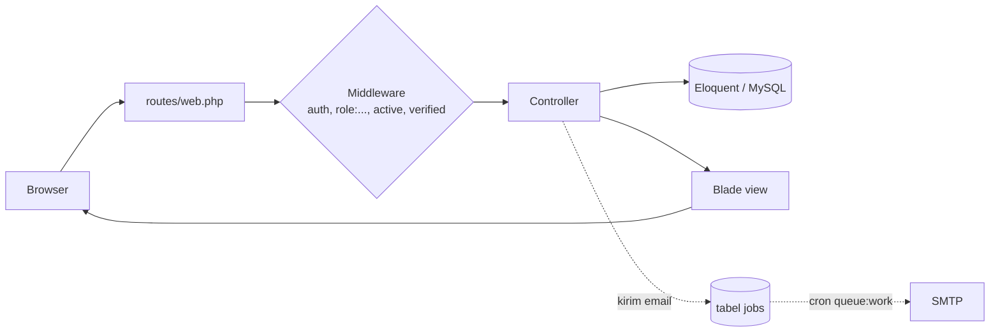

# Arsitektur

## Stack

| Bagian | Teknologi |
|---|---|
| Backend | Laravel 10, PHP 8.1+ |
| Database | MySQL. Primary key kebanyakan UUID string, dibuat oleh trait `App\Helpers\UUIDGenerator`. |
| Auth | Session login bawaan `laravel/ui` (`Auth::routes(['verify' => true])`), verifikasi email untuk agen |
| Role | `spatie/laravel-permission` (4 role, lihat [04-role-permission.md](04-role-permission.md)) |
| PDF | `barryvdh/laravel-dompdf` (invoice, surat jalan) |
| Excel | `maatwebsite/excel` (export laporan, import master data) |
| Gambar | `intervention/image` |
| Captcha | `anhskohbo/no-captcha` di form register |
| Queue | Driver `database` (tabel `jobs`), dipakai untuk email |
| Tampilan | Blade. CMS memakai template Tailwind 3 yang sudah jadi di `public/assets/cms`; landing page memakai template Bootstrap di `public/assets/landing`. |

`tymon/jwt-auth` dan `laravel/sanctum` terpasang, tapi API hanya punya satu route (`GET api/user`). Aplikasi ini sepenuhnya server-rendered.

## Struktur folder yang penting

```
app/
├── Console/Kernel.php        # Jadwal: queue:work tiap menit (lihat 08-deployment.md)
├── Exports/                  # 16 class export Excel
├── Imports/                  # Agent, Package, Product, SubProduct
├── Helpers/
│   ├── UUIDGenerator.php     # Trait: isi id UUID v4 saat creating
│   ├── ValidateRole.php      # ValidateRole::check('admin|super_admin') = hasRole
│   ├── GenerateRandomString.php
│   ├── GetProduct.php        # Cari produk berdasarkan nama (LIKE)
│   ├── PaginationHelper.php  # Paginate array biasa
│   └── ResponseFormatter.php # Tidak dipakai di mana pun
├── Http/
│   ├── Controllers/
│   │   ├── Admin/            # Master data, distribusi, keuangan, laporan
│   │   │   └── Landingpage/  # CRUD konten landing page
│   │   ├── Agent/            # Dashboard, profil, laporan agen
│   │   ├── Auth/             # laravel/ui + ganti email/password
│   │   ├── Transaction/      # Pesanan, pembayaran, retur, invoice
│   │   └── *.php             # Sub agen, administrasi, reward, tutorial, periode, pengadaan, gambar
│   └── Middleware/IsActive.php
├── Mail/                     # 4 notifikasi, semuanya ShouldQueue
└── Models/                   # 39 model
resources/views/
├── cms/                      # Semua halaman setelah login
│   ├── layouts/              # app, sidebar, topbar, mobile-menu, paginate
│   ├── admin/                # Per modul: products, pakets, payment, distributions, finance, reports, ...
│   ├── agen/                 # Halaman khusus agen
│   ├── transactions/         # Pesanan: biasa, full/, aman/, agent/, modal/
│   ├── return/
│   └── sub-agent/
├── landing/                  # Halaman publik
├── exports/                  # detail_order.blade.php (Excel detail pesanan)
├── mail/                     # Template email
└── auth/
routes/
├── web.php                   # Grup role, memanggil file di bawah
├── admin/  agent/  transaction/  landingpage/
└── api.php
```

## Alur request



Pola yang dipakai hampir semua controller:

- Validasi dengan `$request->validate([...])` atau `Validator::make`.
- Tulis data di dalam `DB::transaction(function () { ... })`.
- Sukses: `back()->with('success', '...')` atau `redirect()->route(...)->with('success', ...)`. Gagal: `with('error', $e->getMessage())`. Pesan ini ditampilkan oleh `cms/layouts/topbar.blade.php`.
- Tidak ada Form Request, Service, Repository, atau Policy. Logika bisnis ada langsung di controller, dan sebagian di `@php` dalam Blade.

## Role di dalam controller dan view

- Controller: `ValidateRole::check('agent')`. Contoh di `OrderController@index`: agen hanya melihat pesanannya sendiri (`where('agent_id', Auth::id())`).
- Blade: `@hasrole('admin|super_admin|finance_admin') ... @endhasrole`, dipakai sekitar 190 kali.

## Email dan queue

Empat Mailable di `app/Mail`, semuanya `implements ShouldQueue`, jadi `Mail::to(...)->send(...)` hanya memasukkan job ke tabel `jobs`:

| Mailable | Dikirim dari | Kapan |
|---|---|---|
| `NotificationApproveUser` | `Admin\UserController@changeStatus` | Admin mengaktifkan akun agen |
| `NotificationAccOrder` | `Transaction\OrderController@changeOrderStatus` | Status pesanan diubah |
| `NotificationPayment` | `PaymentController@storePayment`, `@storePaymentAgent` | Pembayaran dicatat |
| `NotificationDistribution` | Di-comment di `DistributionController@store` | Tidak aktif |

Job diproses oleh `queue:work`. Di server dijalankan lewat cron, lihat [08-deployment.md](08-deployment.md).

## Upload gambar

Controller menyimpan file ke `storage/app/public/images/<folder>/`, dan database hanya menyimpan nama file. View menampilkannya dengan:

```blade
{{ route('getImage', ['path' => 'product', 'imageName' => $item->product->detail->image]) }}
```

Kalau `image` kosong atau masih nilai default `image.jpg`, view memakai `assets/logo2.png`.

## Uang

- Kolom uang bertipe `decimal(15,2)` atau `decimal(20,2)`.
- `products.total_price = price × days`, dihitung di `Admin\ProductController`.
- `order_details.sub_price = products.total_price × qty`, dihitung di server. Jangan mengambil angka harga dari input browser (lihat [09-known-issues.md](09-known-issues.md)).
- `orders.total_price` = jumlah `sub_price` semua detail.
- Tampilan Rupiah di Blade: `number_format($x, 0, ',', '.')`. Di JS: `Intl.NumberFormat('id-ID', { style: 'currency', currency: 'IDR' })`. Format ini menghasilkan `,00` di belakang, jadi jangan parse ulang teks hasilnya menjadi angka.
