# Database

Sumber: `database/migrations` (58 file) dan relasi di `app/Models`. Kalau menambah kolom, buat migration baru; jangan mengubah migration lama karena production sudah menjalankannya.

## Hal yang perlu diketahui sebelum menulis query

- **UUID.** Hampir semua tabel bisnis memakai `uuid('id')->primary()`. Model memakai trait `UUIDGenerator` dan `$incrementing = false`, `$keyType = 'string'`. Tabel landing page, `bank_owners`, `rewards`, `commissions`, dan `tutorials` memakai `id()` auto increment.
- **Banyak relasi tanpa foreign key.** Kolom seperti `orders.agent_id` ditulis `$table->uuid('agent_id')->constrained('users')`. `constrained()` pada kolom `uuid()` biasa tidak membuat foreign key, jadi database tidak menjaga relasi dan `onDelete('cascade')` di situ tidak berlaku. Menghapus data induk tidak menghapus anaknya secara otomatis; lakukan di controller. Foreign key sungguhan hanya ada pada kolom `foreignId(...)`: `packages.period_id`, `bank_owner_id` di `payments`/`incomes`/`spendings`/`loans`/`loan_payments`, `rewards.period_id`, dan tabel landing page (`missions`, `gallery_images`, `reviews.review_page_id`, `contact_numbers`).
- **`qty` bertipe string** di `order_details`, `distribution_details`, `spendings`, dan `product_sub_products.amount`. MySQL tetap bisa `SUM`, tapi bandingkan dan hitung di PHP sebagai angka (`(int)`).
- **`users.active` bertipe string** berisi `'0'` atau `'1'`.

## ERD inti

```mermaid
erDiagram
    users ||--o| agent_profiles : "agentProfile"
    users ||--o| admin_profiles : "adminProfile"
    users ||--o| administrations : "administration"
    users ||--o{ sub_agents : "subAgent (agent_id)"
    users ||--o{ orders : "order (agent_id)"
    users ||--o{ product_returns : "productReturn"
    users ||--o{ reviews : "review"

    periods ||--o{ packages : "package"
    periods ||--o{ rewards : ""
    packages ||--o{ product_packages : "product"
    products ||--o| product_packages : "package"
    packages ||--o| package_catalog : "catalog"
    catalogs ||--o| package_catalog : ""
    packages ||--o{ commissions : ""
    products ||--o| product_details : "detail"
    products ||--o| product_suppliers : "supplier"
    suppliers ||--o| product_suppliers : ""
    products ||--o{ product_sub_products : "subProduct"
    sub_products ||--o{ product_sub_products : ""

    orders ||--o{ order_details : "detail"
    products ||--o{ order_details : "order"
    sub_agents ||--o{ order_details : "orderDetail"
    orders ||--o{ payments : "payment"
    bank_owners ||--o{ payments : ""
    orders ||--o{ distributions : "distributions"
    distributions ||--o{ distribution_details : "detail"
    order_details ||--o{ distribution_details : "distributionDetail"

    product_returns ||--o{ product_return_details : "productReturnDetail"
    orders ||--o{ product_return_details : ""
    products ||--o{ product_return_details : ""
    sub_products ||--o{ product_return_details : ""
```



Label di garis adalah nama method relasi di model sisi kiri.

### Rantai dari produk ke periode

Produk terhubung ke periode lewat tabel pivot, sehingga eager load dan `whereHas` di seluruh aplikasi berbentuk:

```php
$order->detail->first()?->product?->package?->package?->period
// Product::package()        -> hasOne ProductPackage
// ProductPackage::package() -> belongsTo Package
// Package::period()         -> belongsTo Period

Order::whereHas('detail.product.package.package.period', fn ($q) => $q->where('is_active', 1));
```

Setiap mata rantai bisa `null` (produk tanpa paket, paket tanpa periode). Selalu pakai `?->` di view.

## Tabel

### Akun dan agen

**users**: `id` uuid, `email` unique, `email_verified_at`, `password`, `active` string `'0'`/`'1'`, `is_open_access` bool (default false), `remember_token`, timestamps. Role disimpan di tabel Spatie `model_has_roles`.

**agent_profiles**: `id` uuid, `user_id`, `name`, `photo`, `ktp_address`, `address`, `phone_number`, `rt`, `rw`, `village`, `district`, `regency`, `province`.

**admin_profiles**: `id` uuid, `user_id`, `name`.

**administrations**: dokumen pendaftaran agen. `id` uuid, `user_id`, `ktp` (nama file), `sPerjanjian` (nama file surat perjanjian).

**sub_agents**: `id` uuid, `agent_id` (users), `name`, `phone_number`, `address`.

**roles, permissions, model_has_roles, model_has_permissions, role_has_permissions**: tabel Spatie. `model_id` bertipe uuid.

### Produk dan paket

**periods**: `id` bigint, `start_date`, `end_date`, `access_date`, `description`, `is_active` bool. Accessor `status` menghasilkan `active`, `inactive`, atau `upcoming` dari tanggal sekarang; ini berbeda dari kolom `is_active` yang dipakai filter menu.

**catalogs**: `id` uuid, `name`, `description`.

**packages**: `id` uuid, `name`, `description`, `image`, `period_id` (FK ke periods).

**package_catalog**: pivot `package_id`, `catalog_id`. Model `PackageCatalog`.

**products**: `id` uuid, `name`, `unit`, `price` decimal(15,2) (harga per hari), `days` int, `total_price` decimal(15,2) (= price × days), `is_safe_point` bool.

**product_details**: `product_id`, `description`, `image`. Satu baris per produk, tanpa kolom `id`.

**product_packages**: pivot `product_id`, `package_id`. Model `ProductPackage`.

**suppliers**: `id` uuid, `name`, `address`, `phone_number`.

**product_suppliers**: pivot `product_id`, `supplier_id`.

**sub_products**: `id` uuid, `name`, `unit` (`Rupiah` atau `Pcs`), `price` decimal(10,2).

**product_sub_products**: `id` uuid, `product_id`, `sub_product_id`, `amount` string. `Product::sumRupiah()` menjumlahkan `amount × price` untuk sub produk ber-unit `Rupiah`.

### Transaksi

**orders**: `id` uuid, `order_number`, `agent_id` (users), `total_price` decimal(15,2), `order_date`, `status` (default `pending`), `payment_status` (default `unpaid`), `delivery_status` (default `pending`), `description`.

| Kolom | Nilai yang dipakai di kode |
|---|---|
| `status` | `pending`, `accepted`, `reject`, `canceled`, `stop` (Mundur) |
| `payment_status` | `unpaid`, `pending` (dicicil), `paid` (lunas) |
| `delivery_status` | `pending`, `success` (semua qty sudah didistribusikan) |

**order_details**: `id` uuid, `order_id`, `product_id`, `sub_agent_id` nullable (null = barang untuk agen sendiri), `sub_price` decimal(15,2) (= `products.total_price × qty`), `qty` string.

**payments**: `id` uuid, `order_id`, `invoice_number`, `pay` decimal(15,2), `method`, `bank`, `bank_owner_id` (FK bank_owners, nullable), `status` enum `pending`/`accepted`/`rejected`, `is_confirmed` bool, `note`, `date`, `photo` (bukti transfer).

**distributions**: `id` uuid, `distribution_number`, `date`, `police_number`, `driver`, `order_id`, `status` enum `on_process`/`delivered`/`cancelled`, `is_delivery` bool (true = diantar), `print_count` int.

**distribution_details**: `id` uuid, `distribution_id`, `order_detail_id`, `qty` string, `order_number`.

**product_returns**: `id` uuid, `return_number`, `user_id` (agen), `status` enum `pending`/`processed`/`finished`/`rejected`, `date_in`, `date_out`, `notes`.

**product_return_details**: `id` uuid, `product_return_id`, `order_id`, `product_id`, `sub_product_id` nullable, `status_product` enum `damaged`/`expired`/`overstock`/`other`, `qty` int, `proof_image`.

### Keuangan

**bank_owners**: `id` bigint, `name`, `account_name`, `account_number`. Rekening tujuan pembayaran dan sumber arus kas.

**incomes**: `id` uuid, `information`, `amount` decimal(20,2), `method`, `bank`, `bank_owner_id`, `date`.

**spending_types**: `id` uuid, `name`.

**spendings**: `id` uuid, `information`, `spending_type_id`, `amount`, `total_amount` decimal(20,2), `method`, `bank`, `bank_owner_id`, `qty` string, `date`.

**loans**: `id` uuid, `borrower_name`, `amount`, `method`, `bank_owner_id`, `status_payment` enum `unpaid`/`paid`/`pending`, `date`, `description`.

**loan_payments**: `id` uuid, `loan_id`, `pay`, `date`, `method`, `bank_owner_id`, `is_confirmed`, `photo`, `description`.

**commissions**: `id` bigint, `package_id`, `title`, `term` int (target qty), `reward` string (nilai tetap atau persen), `description`.

**rewards**: `id` bigint, `period_id` (FK), `title`, `target_qty`, `description`, `image`.

### Landing page

| Tabel | Kolom utama |
|---|---|
| `headers` | `title`, `subTitle`, `description`, `image`, `buttonTitle`, `buttonUrl` |
| `profiles` | `title`, `description`, `image`, `buttonTitle` |
| `detail_profiles` | `titleHistory`, `bodyHistory`, `image`, `titleVM`, `vision` |
| `missions` | `detail_profile_id`, `content` |
| `contacts` | `title`, `subTitle`, `address`, `email`, `mapUrl` |
| `contact_numbers` | `contact_id`, `number`, `description` |
| `galleries` | `title`, `subTitle` |
| `gallery_images` | `gallery_id`, `image`, `image_thumb` |
| `review_pages` | `title`, `subTitle` |
| `reviews` | `review_page_id`, `user_id`, `name`, `rating`, `body`, `image`, `publish` |
| `benefits` | `title`, `subtitle`, `benefit_agen`, `benefit_mitra` |
| `tutorials` | `title`, `description`, `link`, `role`, `status` |

### Sistem

`password_reset_tokens`, `password_resets`, `failed_jobs`, `jobs`, `personal_access_tokens`.
