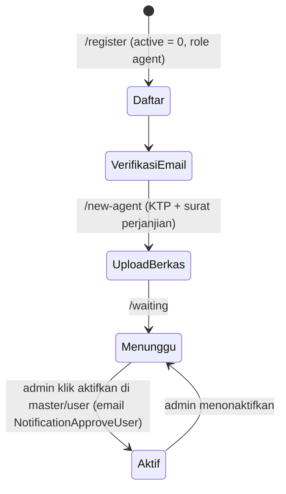

# Role dan Hak Akses

Role dikelola `spatie/laravel-permission`. Seeder: `RoleAndPermissionSeeder`.

| Role | Untuk |
|---|---|
| `super_admin` | Pemilik sistem. Semua menu, termasuk Tutorial. |
| `admin` | Operasional: pesanan, master data, landing page, distribusi, laporan. |
| `finance_admin` | Keuangan: pembayaran, arus kas, pemasukan, pengeluaran, pinjaman, pengadaan, distribusi, laporan. |
| `agent` | Agen penjual. Hanya melihat dan mengelola datanya sendiri. |

Seeder juga membuat permission `manage_users`, `add_order`, `approve_order`, tetapi tidak ada kode yang memeriksanya (`@can`, `->can()`). Semua pembatasan memakai role.

## Tiga lapis pembatasan

1. **Route**: middleware `role:a|b` di `routes/web.php`. Ini satu-satunya lapis yang benar-benar menolak request.
2. **Controller**: `ValidateRole::check('agent')` untuk menyaring data, contohnya agen hanya mendapat pesanan dengan `agent_id` miliknya.
3. **View**: `@hasrole(...)` untuk menyembunyikan menu dan tombol. Menyembunyikan tombol tidak melindungi route, jadi untuk aksi baru selalu pasang middleware role di route juga.

## Matriks akses per area

Daftar lengkap per route ada di [05-routes.md](05-routes.md).

| Area (prefix URL) | super_admin | admin | finance_admin | agent |
|---|:-:|:-:|:-:|:-:|
| Dashboard admin `admin` | ✓ | ✓ | ✓ | |
| Laporan `report/*`, export, import | ✓ | ✓ | ✓ | |
| Distribusi `distribution` | ✓ | ✓ | ✓ | |
| Rekening `master/bank-owner` | ✓ | ✓ | ✓ | |
| Master data `master/*` (user, katalog, paket, produk, sub produk, supplier, landing page, reward, komisi, opsi/periode) | ✓ | ✓ | | |
| Hitung ulang harga `master/countPrice`, `master/countAll` | ✓ | ✓ | | |
| Keuangan `finance/*` | ✓ | | ✓ | |
| Kelola pembayaran `transaction/payment` | ✓ | ✓ | ✓ | |
| Pesanan `transaction/order*`, retur `transaction/return` | ✓ | ✓ | ✓ | ✓ (milik sendiri) |
| Bayar sebagai agen `transaction/payment-agent` | ✓ | ✓ | ✓ | ✓ |
| Sub agen `master/sub-agent` | ✓ | ✓ | | ✓ |
| Kelola tutorial `master/tutorial` | ✓ | | | |
| Dashboard, profil, laporan agen, ulasan | | | | ✓ (aktif dan email terverifikasi) |

## Middleware tambahan

| Alias | Class | Fungsi |
|---|---|---|
| `active` | `App\Http\Middleware\IsActive` | `users.active == 0` diarahkan ke `nonactive` (`/new-agent`) untuk melengkapi berkas |
| `verified` | `EnsureEmailIsVerified` | Wajib verifikasi email, dipakai di grup agen |

## Status akun agen

`users.is_open_access` (diatur admin di master/user) membuka akses ubah item pesanan di luar periode aktif. Dicek di view detail pesanan dan arsip: `$canModifyItem = $isItemWithinPeriod || Auth::user()->is_open_access`.

## Menambah halaman baru

1. Taruh route di grup role yang sesuai di `routes/web.php` atau file di `routes/<area>/`.
2. Kalau datanya milik agen, saring di controller dengan `ValidateRole::check('agent')` dan `Auth::id()`.
3. Tambahkan menu di `resources/views/cms/layouts/sidebar.blade.php` di dalam blok `@hasrole` yang sama, dan di `mobile-menu.blade.php`.
4. Jalankan ulang generator [05-routes.md](05-routes.md).
