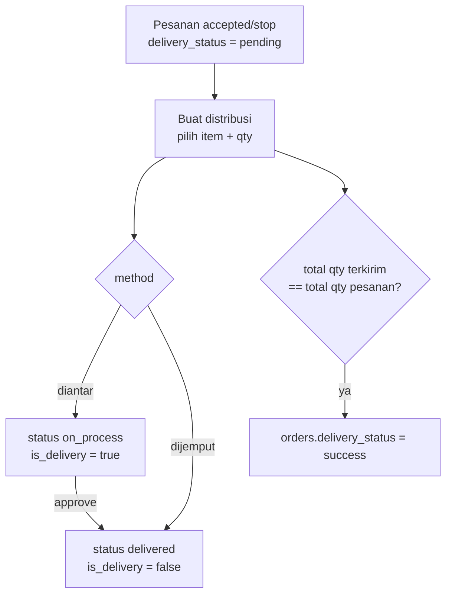

# Modul Distribusi

Mencatat pengiriman barang pesanan ke agen. Satu pesanan bisa dikirim beberapa kali (sebagian-sebagian).

## Alur

## Route

| Aksi | Route | Method |
|---|---|---|
| Daftar, buat, lihat, hapus | `Route::resource('distribution')` | `Admin\DistributionController` |
| Tandai terkirim | `PUT distribution/{distribution}/approve` | `@approve` → `status = delivered` |
| Surat jalan PDF | `GET distribution/export/{distribution}` | `Admin\ExportDeliveryOrderController@getDeliveryOrder` |
| Catat sudah dicetak | `POST distribution/export/{distribution}/printed` | `@printed` → `print_count + 1` |

Akses: `super_admin`, `admin`, `finance_admin`.

## Detail

- `create()` hanya menawarkan pesanan dengan `status` `accepted`/`stop` dan `delivery_status = pending`.
- Form mengirim `products` sebagai JSON `{ productId (= order_details.id), qty, orderNumber }`. Setiap item menjadi satu `distribution_details`.
- Setelah simpan, controller menjumlah qty semua distribusi pesanan itu. Kalau sama dengan total qty `order_details`, `delivery_status` menjadi `success`.
- `destroy()` menghapus distribusi dan mengembalikan `delivery_status` ke `pending`.
- `Order::isAllItemDistributed()` membandingkan jumlah qty detail dengan qty terdistribusi.
- Email `NotificationDistribution` di-comment, jadi agen tidak mendapat email.

## File terkait

- Controller: `app/Http/Controllers/Admin/DistributionController.php`, `ExportDeliveryOrderController.php`
- Model: `Distribution`, `DistributionDetail`
- View: `resources/views/cms/admin/distributions/`, PDF surat jalan di `cms/admin/distributions/export/distribution-order.blade.php`
