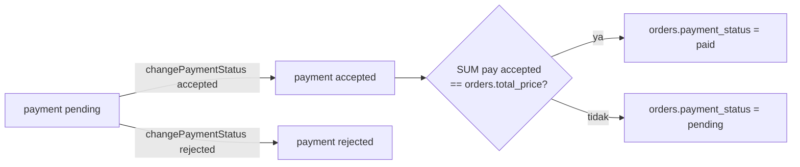

# Modul Pembayaran

Pesanan dibayar dengan cicilan. Setiap cicilan adalah satu baris `payments`. Hanya pembayaran berstatus `accepted` yang dihitung.

## Dua cara mencatat pembayaran

| Oleh | Route | Method | Status awal |
|---|---|---|---|
| Admin / finance | `POST transaction/payment/{order}` | `PaymentController@storePayment` | `accepted` |
| Agen | `POST transaction/payment-agent/{order}` | `PaymentController@storePaymentAgent` | `pending` |

Keduanya:

- Membuat `invoice_number` = `INV` + 5 karakter acak + urutan cicilan + tanggal `dmY`.
- Menyimpan bukti transfer (opsional, maks 2 MB) ke `storage/app/public/images/proofs/payment_<timestamp>.<ext>`.
- Mengisi `bank_owner_id` dari pilihan rekening dan `bank` dari nama rekening tersebut.
- Mengirim email `NotificationPayment` lewat queue.

## Status

| Kolom | Arti |
|---|---|
| `payments.status` | `pending` (menunggu dicek), `accepted`, `rejected` |
| `payments.is_confirmed` | Tanda dana sudah dicek finance. Di-toggle `PUT transaction/changePaymentVerify/{payment}`. Tidak memengaruhi `payment_status`. |
| `orders.payment_status` | `unpaid` (belum ada cicilan), `pending` (dicicil), `paid` (lunas) |

`payment_status` dihitung ulang di `storePayment`, `storePaymentAgent`, `changePaymentStatus`, `destroy`, dan juga oleh `DetailOrderController` ketika isi pesanan berubah. Perbandingannya `==`, sehingga kelebihan bayar membuat status tetap `pending`.

## Halaman

| Halaman | Route | View |
|---|---|---|
| Daftar agen dan status bayar (admin) | `GET transaction/payment` | `cms/admin/payment/index` |
| Pesanan satu agen | `GET transaction/payment/{user}` | `cms/admin/payment/show` |
| Cicilan satu pesanan | `GET transaction/payment/{user}/{order}` | `cms/admin/payment/detail` |
| Pembayaran milik agen | `GET transaction/payment-agent` | `cms/agen/payment/index` |
| Cicilan satu pesanan (agen) | `GET transaction/payment-agent/{user}/{order}` | `cms/agen/payment/detail` |
| Faktur cicilan PDF | `GET transaction/invoice/{order}/{payment}` | `ExportInvoiceController@getInvoice` |

Di halaman daftar admin, status agen dirangkum: `Lunas` kalau semua pesanannya `paid`, `Dicicilkan` kalau ada yang `pending`, selain itu `Belum Lunas`.

## File terkait

- Controller: `app/Http/Controllers/Transaction/PaymentController.php`, `ExportInvoiceController.php`
- Model: `Payment`, `BankOwner`
- Route: `routes/transaction/payment.php`, `routes/transaction/status.php`, grup `transaction` di `routes/web.php`
- Mail: `app/Mail/NotificationPayment.php`, view `resources/views/mail/`

## Aturan saat mengubah

- Setiap perubahan pada `payments` atau `orders.total_price` harus diikuti perhitungan ulang `payment_status`. Logika ini sekarang disalin di beberapa method; kalau mengubah aturannya, ubah di semua tempat.
- Route `changePaymentStatus` dan `changePaymentVerify` saat ini bisa dipanggil role `agent` (lihat [09-known-issues.md](../09-known-issues.md)).
