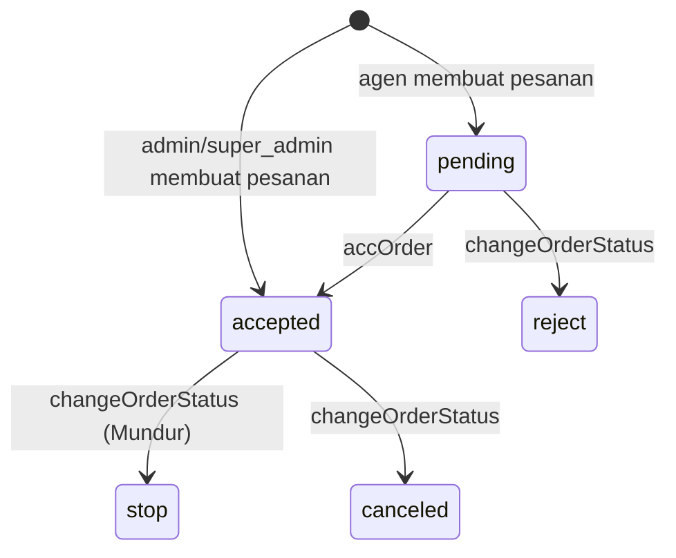

# Modul Pesanan

Agen memesan produk dari paket di periode aktif. Admin menyetujui, finance mencatat cicilan, lalu barang didistribusikan.

## Tiga menu, satu tabel

Semua pesanan ada di tabel `orders`. Menu hanya membedakan isinya:

| Menu | Controller | Filter di `index` |
|---|---|---|
| Pesanan (semua) | `Transaction\OrderController` | Produk di periode aktif |
| Paket Full | `Transaction\OrderFullController` | Punya minimal satu produk `is_safe_point = false` |
| Titik Aman | `Transaction\OrderAmanController` | Semua produknya `is_safe_point = true` |

Ketiganya juga punya `archive` dan `archiveShow` untuk pesanan dari periode yang tidak aktif. Di sidebar admin, menu Pesanan (semua) dan submenu Full/Titik Aman tampil bersamaan; agen hanya melihat Full dan Titik Aman.

## Alur status

- `accOrder` (`POST transaction/acc/{order}`) hanya mengubah status ke `accepted`.
- `changeOrderStatus` (`POST transaction/changeOrderStatus/{order}`) menyimpan `status` dan `description`, lalu mengirim email `NotificationAccOrder` ke agen.
- Pembayaran dan distribusi hanya menampilkan pesanan `accepted` dan `stop`.

## Membuat pesanan

| Pembuat | View | Route simpan |
|---|---|---|
| Admin, Full | `cms/transactions/full/create.blade.php` | `POST transaction/order/full` → `OrderFullController@store` |
| Agen, Full | `cms/transactions/full/create-agent.blade.php` | sama |
| Admin, Titik Aman | `cms/transactions/aman/create.blade.php` | `POST transaction/order/titik-aman` → `OrderAmanController@store` |
| Agen, Titik Aman | `cms/transactions/aman/create-agent.blade.php` | sama |
| Menu semua | `cms/transactions/create.blade.php`, `agent/create.blade.php` | `POST transaction/order` → `OrderController@store` |

Form mengirim:

- `agent_id`, `order_number` (dibuat di `create()`), `order_date`, `total_price`
- `products`: string JSON berisi array `{ productId, subAgentId, qty, subTotal }`

Di `store()`:

1. Validasi dengan `Validator::make`.
2. Khusus Full: agen yang sudah punya pesanan Full (selain `reject`) di periode aktif ditolak.
3. Item dengan `productId` dan `subAgentId` yang sama digabung (qty dijumlah).
4. `sub_price` setiap detail dihitung di server: `Product::total_price × qty`. Nilai `subTotal` dari browser diabaikan.
5. `orders.total_price` di-update menjadi jumlah `sub_price`.

## Detail pesanan

View `cms/transactions/{,full/,aman/}detail.blade.php` menampilkan tabel item yang bisa difilter per agen/sub agen (`?select=`) dan produk (`?productId=`). Query filter ini ditulis langsung di `@php` dalam Blade.

Aksi di halaman detail:

| Aksi | Route | Method |
|---|---|---|
| Ubah qty/produk satu item | `POST transaction/.order/{detail}/detail` | `DetailOrderController@editDetail` |
| Tambah produk | `POST transaction/.order/{order}/addItems` | `DetailOrderController@addItems` |
| Export detail ke Excel | `?export=true` di route show | `DetailOrderExport` |
| Invoice PDF pesanan | `GET transaction/invoice/{order}` | `ExportInvoiceController@getInvoiceOrder` |
| Hitung ulang harga | `GET master/countPrice/{order}` | `CountPriceTransactionController@count` |

`editDetail` dan `addItems` sama-sama menghitung ulang `sub_price` dari harga produk, lalu `total_price` pesanan, lalu `payment_status` (lunas kalau total bayar `accepted` sama dengan total harga).

Item hanya bisa diubah dalam periode aktif. Di luar itu tombol ubah disembunyikan, kecuali user punya `is_open_access` (lihat [04-role-permission.md](../04-role-permission.md)).

Modal tambah produk ada di `cms/transactions/modal/add-product.blade.php` dan `add-product-aman.blade.php`.

## Konversi ke Titik Aman

`POST transaction/bulk-convert-to-safe-point` (`OrderController@bulkConvertToSafePoint`) menerima `order_ids` dipisah koma. Untuk tiap item non-Titik Aman, sistem mencari produk Titik Aman dengan nama mirip (`LIKE %nama%`), mengganti `product_id`, dan menghitung ulang harga. Pencocokan nama ini rapuh: kalau ada dua produk Titik Aman dengan nama mirip, yang terambil adalah yang pertama.

## Hitung ulang massal

`GET master/countAll` menghitung ulang `sub_price` dan `total_price` semua pesanan selain `canceled`/`reject` memakai harga produk saat ini. Pesanan lama ikut berubah kalau harga produk pernah diganti, jadi utamakan `countPrice/{order}` per pesanan.

## File terkait

- Controller: `app/Http/Controllers/Transaction/{Order,OrderFull,OrderAman,DetailOrder}Controller.php`, `app/Http/Controllers/CountPriceTransactionController.php`
- Model: `Order`, `OrderDetail`
- Route: `routes/transaction/order.php`, `routes/transaction/status.php`, grup `transaction` di `routes/web.php`
- View: `resources/views/cms/transactions/`

## Aturan saat mengubah

- Harga selalu dihitung di server dari `products.total_price`. Angka dari form hanya untuk tampilan.
- Setelah mengubah detail, perbarui `orders.total_price` dan `payment_status`.
- Akses rantai periode dengan `?->` (lihat [03-database.md](../03-database.md)).
- Ada tiga salinan view hampir identik (biasa, `full/`, `aman/`). Perubahan tampilan biasanya perlu diterapkan di ketiganya, termasuk versi `archive-detail`.
