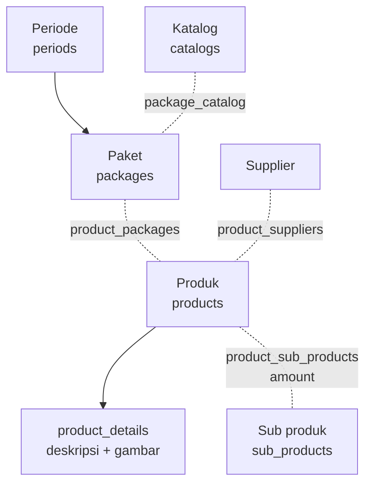

# Modul Produk dan Paket

## Hierarki

Setiap produk punya satu paket, satu supplier, dan satu detail (relasi `hasOne` lewat pivot).

## Periode (menu Opsi)

| Aksi | Route | Method |
|---|---|---|
| Halaman | `GET master/options` | `OptionController@index` |
| Tambah/ubah | `POST master/options/period` | `PeriodController@addOrUpdatePeriod` |
| Aktif/nonaktif | `POST master/options/period/activate` | `PeriodController@activatePeriod` |
| Hapus | `DELETE master/options/period/{period}` | `PeriodController@deletePeriod` |

`is_active` menentukan apa yang tampil di menu utama: pesanan, produk, paket, komisi, dan pembayaran memfilter `period.is_active = 1`. Data periode nonaktif pindah ke halaman Arsip. `activatePeriod` hanya membalik satu periode dan tidak menonaktifkan periode lain, jadi pastikan hanya satu yang aktif; beberapa method mengambil `Period::where('is_active', 1)->first()`.

`access_date` dipakai view detail pesanan untuk menghitung sisa hari akses (`now()->diffInDays($period->access_date)`).

## Produk

| Aksi | Route |
|---|---|
| CRUD | `Route::resource('master/product')` → `Admin\ProductController` |
| Arsip | `GET master/product/archive`, `GET master/product/archive/{product}` |
| Tambah sub produk ke produk | `POST master/product/{product}/sub-product` |
| Hapus sub produk dari produk | `DELETE master/product/{product}/sub-product/{productSubProduct}` |
| Export / import Excel | `GET export-product`, `POST import-product` |

Field form: nama, satuan, `price` (Harga Barang/hari), `days` (Jangka Waktu), paket, supplier, deskripsi, gambar, `is_safe_point`. Controller menyimpan `total_price = price × days`.

Saat produk di-update, `ProductController@update` menghitung ulang `sub_price` semua `order_details` yang memakai produk itu dan `total_price` pesanannya, di semua periode. `payment_status` pesanan tidak ikut dihitung ulang. Akibatnya mengubah harga produk lama juga mengubah tagihan pesanan lama.

Gambar disimpan di `images/product`.

## Paket

`Route::resource('master/package')` → `Admin\PackageController`, ditambah `archive`, `archiveShow`, `export-package`, `import-package`. Gambar di `images/package`.

## Katalog, Supplier, Sub produk

| Data | Controller | Catatan |
|---|---|---|
| Katalog | `Admin\CatalogController` | Mengelompokkan paket (`package_catalog`). Halaman publik `catalogs-product` menampilkan semua produk, bukan per katalog. |
| Supplier | `Admin\SupplierController` | |
| Sub produk | `Admin\SubProductController` | `unit` = `Rupiah` atau `Pcs`. Dipakai laporan kebutuhan, stok, pengadaan, dan retur. Export/import Excel tersedia. |

## File terkait

- Controller: `app/Http/Controllers/Admin/{Product,Package,Catalog,Supplier,SubProduct}Controller.php`, `OptionController.php`, `PeriodController.php`
- Model: `Period`, `Package`, `PackageCatalog`, `Catalog`, `Product`, `ProductDetail`, `ProductPackage`, `ProductSupplier`, `Supplier`, `SubProduct`, `ProductSubProduct`
- Route: `routes/admin/master{Product,Package,Catalog,Supplier,SubProduct}.php`, `routes/admin/options.php`
- View: `resources/views/cms/admin/{products,pakets,catalogs,suppliers,sub-products,options}/`
